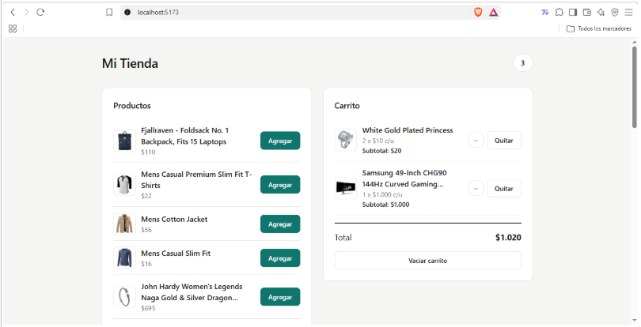

# Carrito de compras con React y Zustand

## Captura de la tienda

La captura muestra:

1. La tienda abierta en `http://localhost:5173`.
2. El catálogo con los productos e imágenes cargados desde fakestoreapi.
3. Al menos 2 productos distintos en el carrito, uno de ellos con cantidad 2.
4. La insignia del encabezado, los subtotales, el total y el botón Vaciar carrito.
5. Una ventana amplia donde se vean las dos columnas (catálogo y carrito).

## Preguntas de reflexión inicial

**1. ¿Por qué Encabezado se actualiza cuando agregas un producto, si no recibe ninguna prop?**

Porque el Encabezado no recibe el carrito por props, sino que lo lee directamente del store con `useCarritoStore`. Cuando agrego un producto, el store cambia y Zustand avisa a los componentes que están usando ese dato, entonces el Encabezado se vuelve a dibujar con el nuevo contador.

**2. ¿Qué tendrías que hacer para lograr lo mismo usando solo useState en App?**

Tendría que crear el estado del carrito con `useState` en App, junto con las funciones para agregar, quitar y vaciar. Después pasaría los items y esas funciones como props a Encabezado, ListaProductos y Carrito. Cada vez que cambie el estado en App, se vuelven a dibujar todos sus hijos para que reciban los datos actualizados.

**3. ¿Para qué sirve el selector (state) => state.items al usar el hook?**

Sirve para decirle a Zustand qué parte del store quiero leer. En este caso solo me interesa `items`, así que el componente se actualiza cuando cambia `items` y no cuando cambia otra cosa. También hace que el código sea más claro porque sé exactamente qué dato estoy usando.

**4. ¿Por qué en el store se crean arreglos nuevos con map y filter en lugar de modificar items directamente?**

Porque si modifico el arreglo original, React puede no darse cuenta del cambio y no actualizar la pantalla. Al crear un arreglo nuevo con `map`, `filter` o el operador spread, el valor cambia de una forma que React sí detecta. También evito errores raros por estar compartiendo el mismo arreglo en varios lugares.

**5. ¿Zustand es parte de React? Explica la diferencia entre una librería propia de React y una del ecosistema.**

No, Zustand no viene dentro de React. React es la librería principal que uso para crear componentes y manejar la interfaz. Zustand es una librería aparte, del ecosistema de React: se instala con npm y sirve para manejar el estado global. Una librería propia de React sería algo que viene incluido con React, como `useState` o `useEffect`; una del ecosistema es una herramienta externa que está pensada para funcionar con React, pero se instala y se mantiene por separado.
